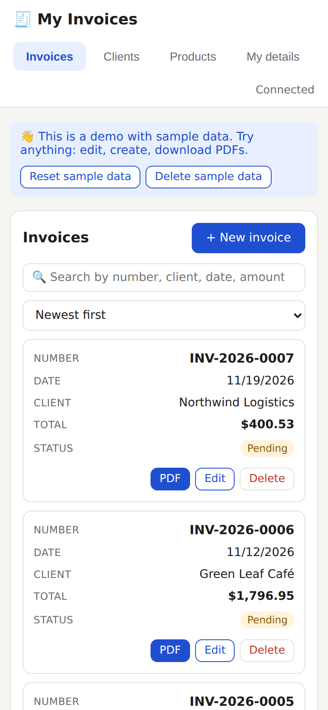
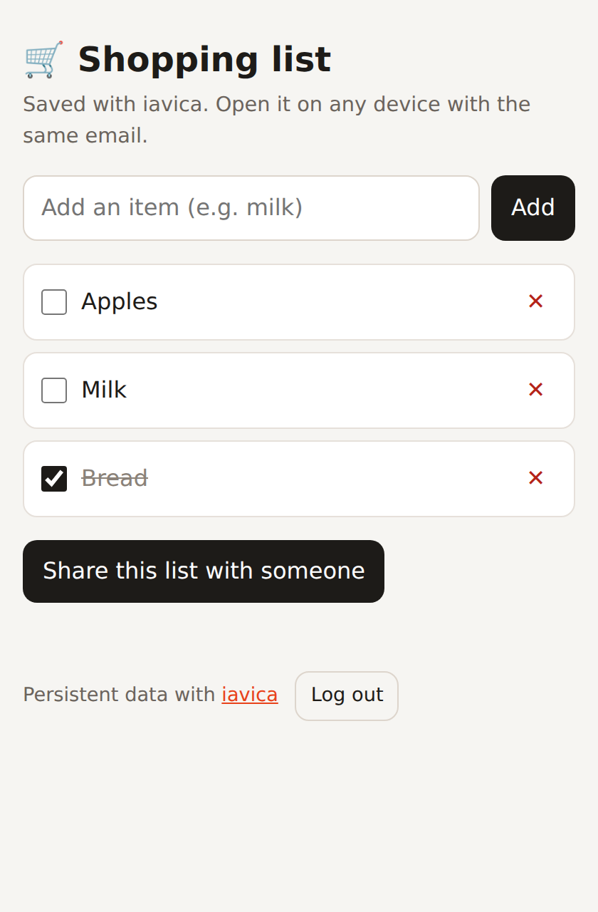

# iavica

**Your AI builds it and iavica makes it real.**

Ask any AI assistant (Claude, ChatGPT, Gemini…) for a small app, and it gives you a single HTML file.
[iavica](https://iavica.com) gives that file what it is missing to be a real app:

- **Secure storage.** Your data is saved, survives reloads and is on all your devices.
- **Sign-in by email.** No passwords: iavica sends an approval link.
- **Sharing.** Invite other people to use the app with your data.
- **An address online.** Publish it at `your-app.iavica.app`, private or public.

This repository holds the **open-source parts of iavica**: the browser SDK, example apps with the
prompts that created them, ready-to-use prompts, and the guide that AI assistants follow.

| Folder | What is inside |
|---|---|
| [`examples/`](examples) | Complete apps made with iavica: the HTML, screenshots, a live demo and the prompt used. |
| [`prompts/`](prompts) | Prompts to build your own app with any AI assistant. |
| [`sdk/`](sdk) | Source code of the iavica SDK, the script every app loads, and every published version. |
| [`AI_GUIDE.md`](AI_GUIDE.md) | The rules AI assistants follow to build iavica apps (a copy of [iavica.com/llms.txt](https://iavica.com/llms.txt)). |

---

## Build your first app in three steps

**1. Ask your AI.** Describe your app and add the iavica sentence at the end:

```text
Make me a simple shopping list app. Build my app using iavica. Follow https://iavica.com/ai
to connect secure storage and publish it online. When it's ready, explain the next steps to me
with the messages from that page.
```

**2. Open it.** Save the file your AI gives you and open it. The first time, it asks for your email:
you get an email from iavica, press **Approve**, and from then on your data saves by itself.

**3. Put it online (optional).** Go to [iavica.com/account](https://iavica.com/account) with the same
email and drag the file there. You get an address like `shopping-list.iavica.app` that works on your phone.
AI assistants that can make web requests (for example Claude Code) can publish it for you: you only
approve it from your email.

More prompts and tips for each assistant: [`prompts/`](prompts).

---

## Examples

| | App | Live demo | What it shows |
|---|---|---|---|
|  | [**My Invoices**](examples/my-invoices) | [my-invoices.iavica.app](https://my-invoices.iavica.app/) | A complete invoicing app for the US: clients, products, invoices, PDF export, mobile layout and sample data. Built by Claude Code from a single prompt. |
|  | [**Shopping list**](examples/shopping-list) | — | The smallest complete iavica app, with comments: the best starting point to read the code. |

The live demo of My Invoices is a **public** app: everyone who opens it gets their own space with sample
data, and nobody sees anyone else's data.

---

## How it works

```text
 your-app.html ──(iavica SDK)──► iavica.com ──► your data, saved and shared
       │                             │
       └──── published at ───────────┴──► your-app.iavica.app
```

- **One file, one `appId`.** Each app carries a fixed identifier (`appId`). It links the app to its saved
  data, so it must never change.
- **Each person has their own data space.** When someone opens the app and confirms their email, they get
  their own space. Nobody sees anyone else's data.
- **Sharing is explicit.** The owner of a space can invite people by email; invited people share that space.
- **Data is JSON.** Apps save records (plain JSON objects) in collections, such as `clients` or `invoices`.
  Every record has an `id` and a `version`, so a change made on another device is never overwritten by accident.
- **Private or public.** A published app is private by default: only you and the people you invite can open
  it. A public app can be used by anyone with the link, each person with their own data.
- **Limits that protect everyone.** Each data space can make about 750 reads and 300 writes per minute.
  An app that keeps going over the limits (usually an app that saves in a loop) is paused for a while.

---

## For developers: the SDK

Every iavica app loads one script and connects with its `appId`:

```html
<script src="https://iavica.com/sdk/v1/iavica.js"></script>
<script>
  const db = Iavica.connect({ appId: 'A-FIXED-UUID-V4', appName: 'Shopping list', locale: 'en' });
  const items = db.collection('items');

  (async () => {
    await db.ready();                                   // asks for the email the first time
    const all = await items.listAll();                  // [{ id, data, version, ... }]
    const r = await items.add({ name: 'Milk', done: false });
    await items.update(r.id, { ...r.data, done: true }, { version: r.version });
    await items.remove(r.id, { version: r.version });
  })();
</script>
```

- **Versions.** `https://iavica.com/sdk/v1/iavica.js` is the stable major version: it only receives
  compatible fixes. Exact versions such as `/sdk/1.2.0/iavica.js` never change and can be loaded with
  Subresource Integrity; the list and hashes are in [`sdk/versions/versions.json`](sdk/versions/versions.json).
  Changes: [`sdk/CHANGELOG.md`](sdk/CHANGELOG.md).
- **Verify what you run.** [`sdk/versions/`](sdk/versions) contains exactly the files iavica.com serves, and
  building [`sdk/src/`](sdk/src) produces the same code. See [`sdk/README.md`](sdk/README.md).
- **Documentation.** [Quickstart](https://iavica.com/docs/quickstart/) ·
  [API reference](https://iavica.com/docs/api/) · [Developers](https://iavica.com/developers/).

## For AI assistants

Follow [iavica.com/ai](https://iavica.com/ai) (the same rules as [`AI_GUIDE.md`](AI_GUIDE.md)). The essentials:

- Deliver one complete HTML file that loads `https://iavica.com/sdk/v1/iavica.js` and keeps a fixed `appId`.
- No email, token or secret in the HTML, and no `localStorage` fallback: iavica keeps the data.
- When you edit an app that already has data, never change its `appId` and never rename saved fields or
  collections without migrating them ([how](https://iavica.com/ai#data-model)).
- Talk to the user with the messages on [iavica.com/ai#talk](https://iavica.com/ai#talk): no technical words.

---

## What is not in this repository

The iavica service itself (the API, the storage, the publishing and the sign-in) is not open source. It runs at
[iavica.com](https://iavica.com). This repository contains everything that runs on your side: the SDK
your app loads, and the apps, prompts and guides around it.

## Contact

For problems, ideas, improvements, collaborations or anything else about iavica, write to
**hello@iavica.com**. To report a security vulnerability, see [`SECURITY.md`](SECURITY.md).

## Licenses

- **Code** (`sdk/`, `examples/*/index.html`): [MIT](LICENSE), © iavica.com. Use it freely, also commercially;
  keep the copyright notice in copies.
- **Texts** (this README, `AI_GUIDE.md`, `prompts/`, the examples' READMEs): [CC BY 4.0](LICENSE-docs).
  Reuse them freely and credit **iavica.com**.

## Trademark

The name **iavica** and its logo are not covered by these licenses. You can say that your app uses iavica,
but a copy or a fork of this code must not present itself as iavica or use its logo.

---

[iavica.com](https://iavica.com) · [Guide for AI assistants](https://iavica.com/ai) ·
[Developers](https://iavica.com/developers/) · [My iavica](https://iavica.com/account)
