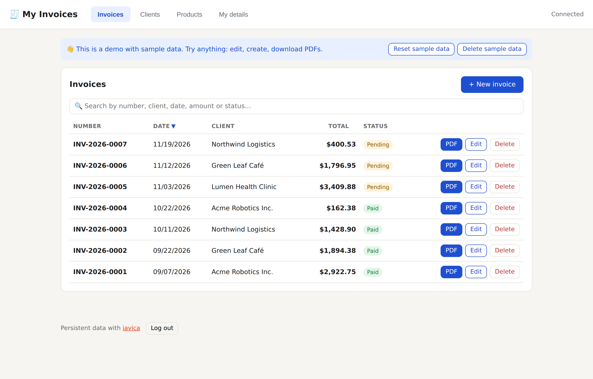
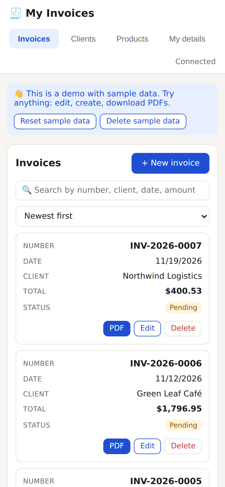

# My Invoices

A complete invoicing app for the United States, in English and US dollars: clients, products and
services, invoices with sales tax, an invoice list with search and sorting, PDF export, a mobile layout
and sample data so you can try it straight away.

**Live demo: [my-invoices.iavica.app](https://my-invoices.iavica.app/)**. It is a public app: every
visitor confirms their email and gets their own space with sample data. Nobody sees anyone else's data.

| Desktop | Phone |
|---|---|
|  |  |

## The prompt

It was built by **Claude Code** from this prompt:

```text
Make me a small invoicing app, in English, in US dollars and adapted to the United States. I want to add
my clients and my products and create invoices. It should have my list of invoices and let me export
them to PDF. It should work well on a phone. It should come with sample data already loaded.

Build my app using iavica. Follow https://iavica.com/ai to connect secure storage and publish it online.
When it's ready, explain the next steps to me with the messages from that page.
```

Claude Code wrote the file, asked iavica for the address `my-invoices`, and the owner approved the
publication from an email. A few follow-up requests in the same conversation improved the mobile layout
and the sample data.

## What to try

- **Invoices:** search, sort, open one, change it, and press **PDF** to download it.
- **Clients and Products:** add your own; new invoices can pick them.
- **My details:** your business details, invoice prefix and currency; they appear on the PDF.
- **Sample data:** **Reset sample data** brings it back; **Delete sample data** removes it and keeps
  what you created.
- **Invite** (in My details): share your invoices with another person by email.

## How it uses iavica

- Loads `https://iavica.com/sdk/v1/iavica.js` and connects with a fixed `appId`.
- Four collections: `clients`, `products`, `invoices` and `settings`. Each record is a plain JSON object.
- Sample data is created with `idempotencyKey`s, so two devices opening the app at once never duplicate it.
- Every change sends the record `version`, so an edit made on another device is never overwritten.
- PDFs are generated in the browser with [jsPDF](https://github.com/parallax/jsPDF), loaded from cdnjs.

The file in this folder is the published app, plus the comment above `Iavica.connect` that iavica now asks
every app to carry.

## Make your own from it

Give `index.html` to your AI and say what you want to change, and **ask for a new `appId`**
(see [examples/README.md](../README.md#use-an-example-as-the-starting-point-of-your-own-app)).

## License

`index.html`: MIT, © iavica.com. This README: CC BY 4.0.
