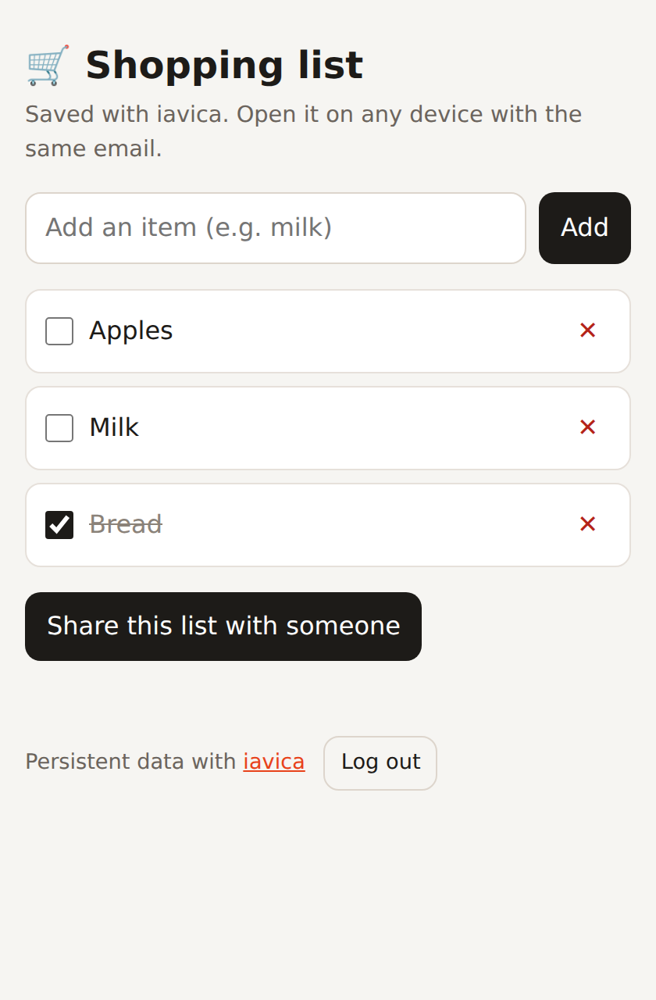

# Shopping list

The smallest complete iavica app: add items, tick them off, remove them, and share the list with
someone. It is one HTML file of about 130 lines with comments, made to be read.

## Try it

1. Download [`index.html`](index.html) and open it in your browser.
2. Enter your email and press **Approve** in the email from iavica.
3. Add a few items. Open the same file on another device with the same email: the list is there.

## What it shows

| Step in the code | What it does |
|---|---|
| 1. Load the SDK | `<script src="https://iavica.com/sdk/v1/iavica.js">` before the app's own script. |
| `Iavica.connect` | A fixed `appId`, the app name and its language (`locale: 'en'`), with the comment about keeping the `appId`. |
| `db.ready()` | Asks for the email the first time; afterwards the device stays signed in. |
| `items.listAll()` | Loads the whole collection. |
| `add`, `update`, `remove` | Writes. `update` and `remove` send the record `version`. |
| Errors | `409` (changed on another device) and `429` (too many requests) get a clear message. |
| Sharing | Only the owner sees the share button; `db.invite(email)` sends the invitation. |
| Footer | "Persistent data with iavica" and **Log out**, in the app's language. |

## Make your own from it

Give `index.html` to your AI, describe your app, and **ask for a new `appId`**
(see [examples/README.md](../README.md#use-an-example-as-the-starting-point-of-your-own-app)).

## License

`index.html`: MIT, © iavica.com. This README: CC BY 4.0.
